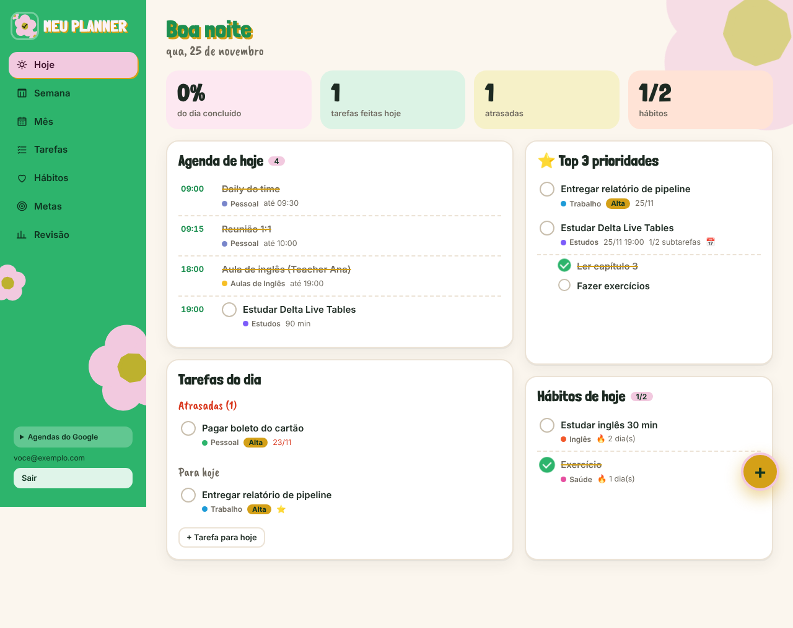
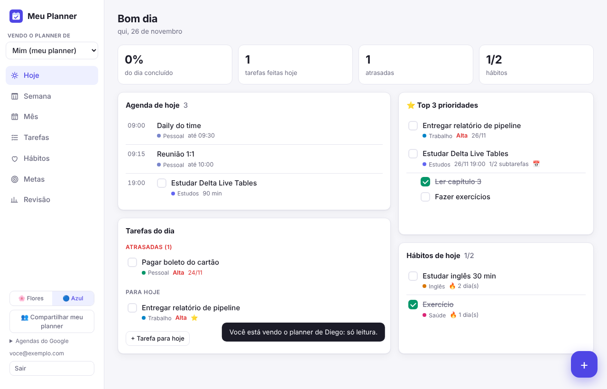
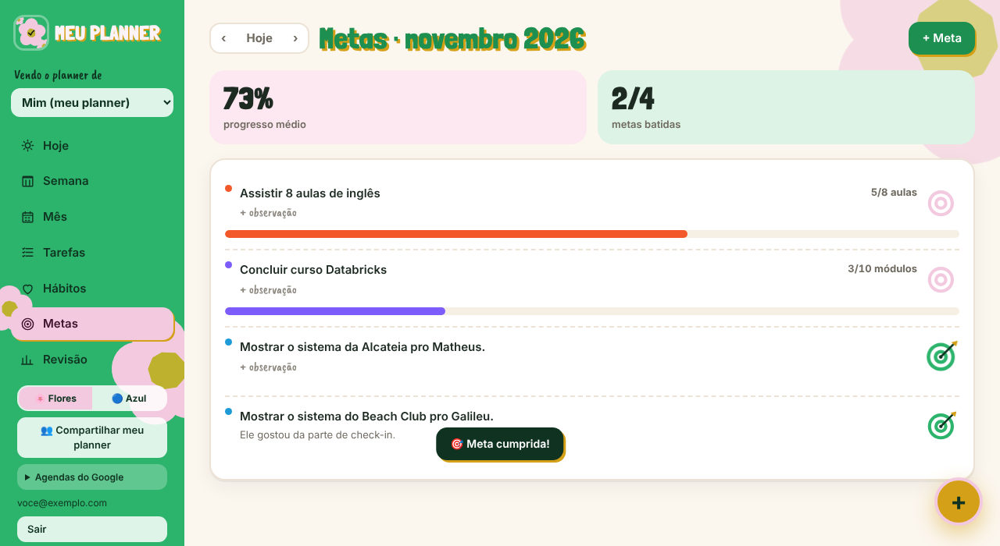

# Meu Planner

Planner pessoal na web, integrado ao **Google Agenda**: tarefas, hábitos, metas do mês e revisão semanal, com visões de **dia, semana e mês**. As tarefas com horário viram eventos no Google Agenda, e o lembrete chega no celular pelo próprio app do Google.

🔗 **App:** https://meu-planner-gray.vercel.app

| Tema Flores | Tema Azul |
|---|---|
|  |  |

> As capturas usam dados fictícios.

## Funcionalidades

- **Hoje:** agenda do dia (eventos do Google + tarefas com horário), top 3 prioridades, tarefas atrasadas e do dia, hábitos e % do dia concluído.
- **Semana e Mês:** calendário com as agendas do Google e as tarefas juntas. Clicar num horário vazio cria uma tarefa.
- **Tarefas:** categorias (Estudos, Trabalho, Financeiro, Pessoal, Saúde), prioridade, subtarefas e lembrete.
- **Hábitos:** marcação diária, meta semanal e sequência de dias seguidos.
- **Metas do mês:** alvo 🎯 que recebe um dardo quando a meta é cumprida, barra de progresso para metas de contagem e observações.
- **Revisão semanal:** números da semana, reflexão, anotações por área, o que ficou pendente e o que vem nos próximos dias.
- **Compartilhamento:** cada pessoa pode liberar a leitura do próprio planner para outro e-mail (só leitura).
- **Dois temas:** 🌸 Flores e 🔵 Azul, salvos por pessoa.



## Arquitetura

```
Navegador (HTML + JS puro, sem build)
   │  supabase-js (chave pública + login Google)
   ▼
Supabase ─ Postgres (schema "planner", RLS por usuária)
   │       └ Edge Function "planner-google-token"
   │           guarda o refresh token do Google e devolve access tokens de 1 h
   ▼
Google Calendar API  ◄── chamada direto do navegador com o access token
```

**Decisões principais**

- **Sem build:** é um site estático (`index.html`, `app.js`, CSS), hospedado na Vercel. O `supabase-js` vem de CDN.
- **Login com Google via Supabase Auth**, pedindo os escopos `calendar.events` e `calendar.calendarlist.readonly` com `access_type=offline`.
- **Refresh token só no servidor:** o navegador recebe os tokens do Google uma única vez, logo após o login. O *refresh token* (que dura meses) é enviado para a Edge Function e fica em `planner.google_tokens`, tabela sem nenhuma policy para o navegador. A troca por *access tokens* curtos usa o Client Secret, que existe só como segredo da função.
- **Notificações pelo Google Agenda:** em vez de Web Push (instável em PWA no iOS), cada tarefa com horário é criada como evento no calendário principal, com lembrete `popup`. A propriedade privada `plannerTaskId` evita que o evento apareça duplicado no app.
- **Segurança no banco (RLS):** cada linha pertence a `auth.uid()`. O compartilhamento é uma tabela `shares` por e-mail, e a função `planner.can_view()` libera só `SELECT` para quem foi autorizado.
- **Sem HTML vindo do usuário:** a interface é montada com um helper `h()` que usa só `textContent`.

## Estrutura

```
index.html            página e troca de tema antes da renderização
app.js                aplicação (estado, telas, Google Calendar, Supabase)
styles.css            tema Flores
azul.css              tema Azul
icon.svg, icon-azul.svg, flor.svg, manifest.webmanifest
logo/                 logotipo, ícone e capa em SVG
supabase/migrations/  SQL do schema "planner"
supabase/functions/planner-google-token/  Edge Function (Deno)
docs/                 capturas de tela
```

## Como rodar o seu

1. **Supabase:** aplique as migrações de `supabase/migrations` e publique a função `supabase/functions/planner-google-token`.
   - Em *Data API → Exposed schemas*, adicione `planner`.
   - Em *Authentication → URL Configuration → Redirect URLs*, adicione a URL do seu site.
2. **Google Cloud:**
   - Crie um projeto e ative a **Google Calendar API**.
   - Configure a tela de consentimento com os dois escopos acima e publique o app ("Em produção"). No modo teste, o refresh token expira em 7 dias.
   - Crie um cliente OAuth do tipo *Aplicativo da Web* com o redirecionamento `https://<seu-projeto>.supabase.co/auth/v1/callback`.
3. **De volta ao Supabase:**
   - Ative o provedor Google com o Client ID e o Client Secret.
   - Crie os segredos `GOOGLE_CLIENT_ID` e `GOOGLE_CLIENT_SECRET` nas Edge Functions.
4. Troque `SUPABASE_URL` e `SUPABASE_ANON` no topo do `app.js` pelos do seu projeto e publique a pasta como site estático (Vercel, Netlify, GitHub Pages…).

A chave que aparece no `app.js` é a chave **pública** (*anon*) do Supabase, feita para ficar no navegador. Quem protege os dados são as regras de RLS do banco.

## Stack

HTML, CSS e JavaScript (ES modules) · Supabase (Postgres, Auth, Edge Functions em Deno) · Google Calendar API · Vercel
